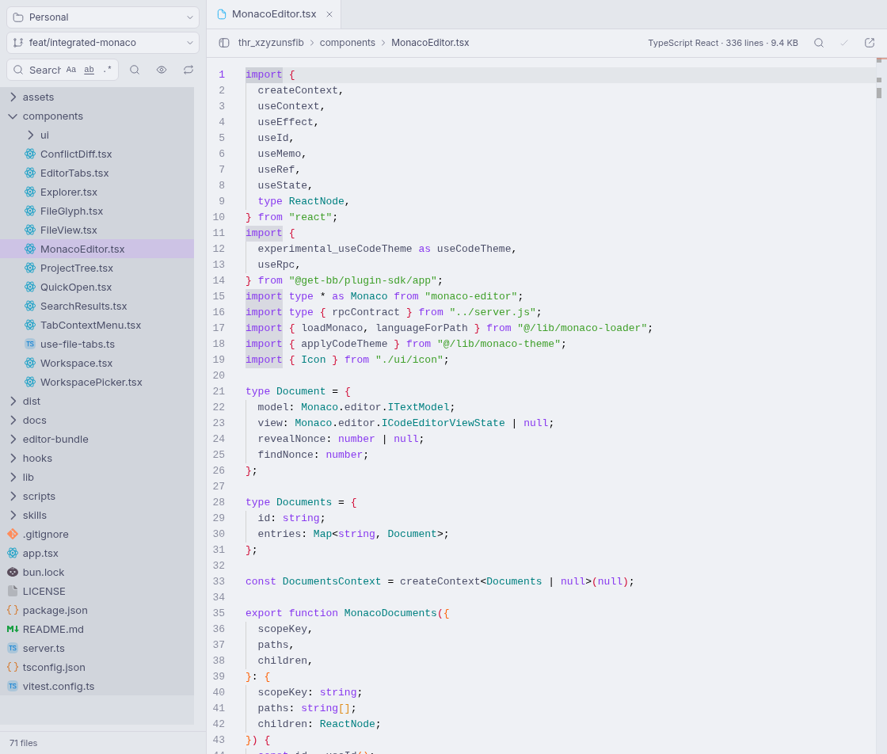

# Files

Edit the files behind a BB thread without leaving BB. Files opens text directly
in Monaco, with a Pierre file tree, editor tabs, project search, and conflict diffs.
You can also open folders on a connected machine, including its filesystem root.

Forked from [AbdElrahman Telb’s Files plugin](https://github.com/abdoutelb/bb-plugin-files-editor).
The original [MIT license and copyright](LICENSE) are preserved.



## Install

Requires BB 0.45.0 or newer with plugin SDK 0.6.15 or newer.

```sh
bb plugin install git:https://github.com/brock6g/bb-plugins.git@main --plugin files-editor
```

This tracks `main`. Run `bb plugin update files-editor` to get later changes.
Bun is only needed when developing the plugin.

If Files is already installed from another Git source, BB will refuse the new
source. Save its settings before replacing it:

```sh
bb plugin config files-editor --json > files-editor-settings.json
bb plugin remove files-editor
bb plugin install git:https://github.com/brock6g/bb-plugins.git@main --plugin files-editor
```

Removal deletes the old plugin's settings. Restore **Excluded directories** from
the backup in BB's plugin settings. This fork keeps the `files-editor` plugin ID.

## Open your workspace

Select **Files** in the sidebar to choose a project and workspace. To keep Files
beside a conversation, open the thread's right panel and select **Project files**.

Text files open ready to edit. Markdown also has a **Preview** tab that renders
the current draft. Images up to 2 MB open as previews; other binary files show their type.

- Use Monaco's syntax highlighting, multiple cursors, folding, find, and replace.
- Switch tabs without losing undo history, cursor position, or scroll position.
- Browse a virtualized Pierre tree, including dotfiles on the server's machine.
- Search file contents across the workspace, or find a file by name.
- Save with a file-hash check so another writer's changes are detected.
- Select **Compare changes** after a conflict to compare the disk version with
  your draft using BB's Pierre diff renderer. Choose **Reload** or **Overwrite**
  after reviewing it.

The active text file is checked for changes every three seconds while Files is
visible, and when you return to the window. Unsaved drafts are preserved.

## Open a server folder

On the sidebar **Files** page, select **Open folder on a machine** beside the
project and workspace pickers. Choose a machine, then select **Browse filesystem**
to start at its root folder. No path is needed.

To open a folder directly, expand **Open a specific folder**, enter an absolute
path such as `/etc` or `C:\Users`, and select **Open folder**.

Directories load as you expand them. **Search loaded files** and **Go to file**
cover files in folders you have loaded, so opening `/` does not scan the entire
disk. **Refresh files** refreshes the root and folders you have already loaded.
File saves keep the same conflict checks as project files.

The Project and Workspace pickers have searchable, scrollable menus that stay
inside the viewport. Use the arrow keys to move through results, **Enter** to
select, and **Escape** to close. Long project and branch names wrap in the menu.

## Use keyboard shortcuts

| Action | macOS | Windows / Linux |
| --- | --- | --- |
| Save | Cmd+S | Ctrl+S |
| Find in file | Cmd+F | Ctrl+F |
| Go to file | Cmd+P | Ctrl+P |
| Search in files | Cmd+Shift+F | Ctrl+Shift+F |

Monaco also provides its own command menu and editing shortcuts.

## Search files

The search field looks inside files. Lowercase queries ignore case; a capital
makes the search case-sensitive. Use the **Aa**, **ab**, and **.*** toggles for match case,
whole words, and regular expressions. Select a result to open its line.

The magnifier beside the field finds files by name. Press **Escape** in the
search field to return to the tree.

## Choose excluded directories

In the plugin settings, **Excluded directories** accepts one name per line.
The defaults are `.git`, `node_modules`, and `vendor`. Add names such as `.venv`
or `dist` to keep large generated directories out of the tree and search.

## Read files from an agent

The plugin adds these commands inside a BB thread:

```sh
bb files root
bb files tree --depth 3
bb files find MonacoEditor
bb files read components/MonacoEditor.tsx
```

Paths resolve against that thread's workspace, including workspaces on connected
machines. Listings and file output are bounded by BB's CLI output limit.

## Develop

From this repository:

```sh
cd plugins/files-editor
bun install --frozen-lockfile
bun run test
bun run typecheck
bun run build
bb plugin install "path:$PWD"
```

After editing, run `bun run build` and `bb plugin reload files-editor`.
`bb plugin dev` watches app and server changes; changes under `editor-bundle/`
also need `bun run build:editor` and a page refresh.

`dist/monaco/` is checked in because BB's Git installer builds the plugin app and
server but does not run the separate Monaco build. Rebuild and include those
assets whenever the editor bundle changes. Other build output stays untracked.

## Limits

- Workspace language servers, cross-file IntelliSense, debugging, and VS Code
  extensions are not integrated.
- Files larger than 4 MB open read-only. Markdown preview is limited to about
  one million characters.
- The tree lists up to 40,000 entries locally or 10,000 on connected machines.
  Connected-machine listings cannot include dotfiles. Server-folder views keep
  at most 40,000 loaded entries; excluded directories still apply.
- Search skips binaries and files larger than 2 MB. It stops at 2,000 matches,
  500 matching files, or ten seconds. Connected-machine search covers up to
  3,000 files. A regular expression that exceeds three seconds is stopped.
- Markdown preview uses BB's message renderer; relative images and links do not
  resolve against the workspace.
- The tree does not create, rename, or delete files.

## Credits and license

Based on [AbdElrahman Telb's Files plugin](https://github.com/abdoutelb/bb-plugin-files-editor),
under the [MIT license](LICENSE). This fork adds Monaco, Pierre Trees, and conflict
comparisons through BB's Pierre diff renderer. Dependency licenses remain with
those projects; Monaco's license and third-party notices ship with its assets.
